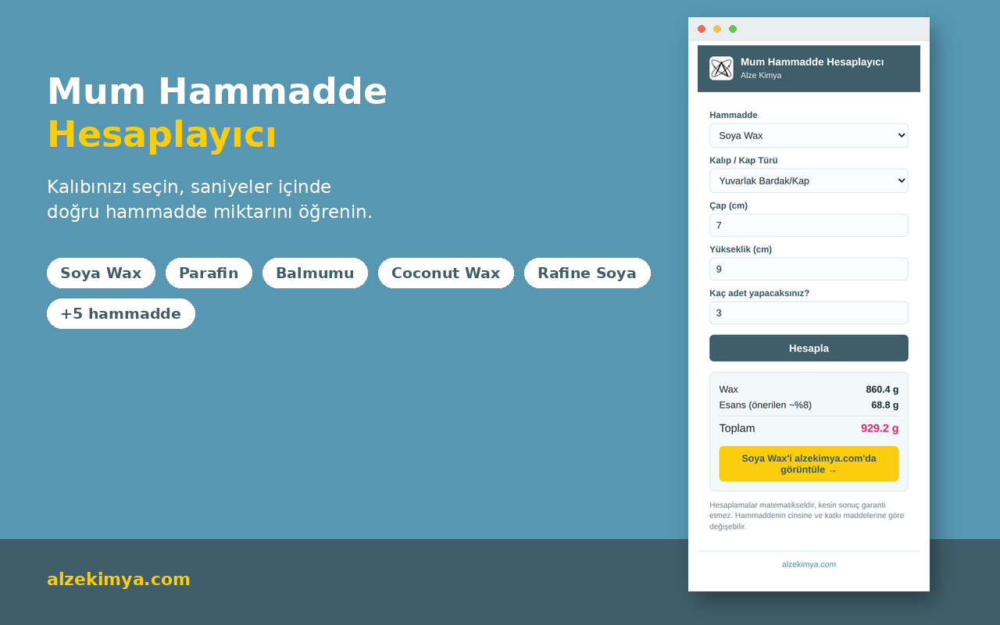
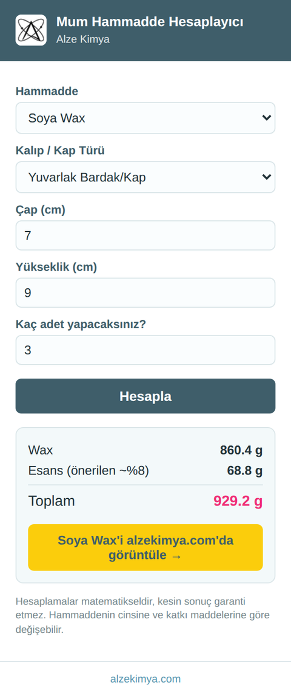

  

# Mum Hammadde Hesaplayıcı — Alze Kimya

Chrome tarayıcısı için ücretsiz bir mum yapımı hesaplayıcısı. Kalıp veya kabınızın ölçüsünü girin; soya wax, parafin, balmumu ve 7 farklı mum hammaddesinden ne kadar gerektiğini saniyeler içinde öğrenin.

Geliştirici: **[Alze Kimya](https://alzekimya.com/)** — Türkiye'nin mum, sabun, epoksi reçine, taş tozu ve makrome hammaddeleri tedarikçisi.

## Özellikler

- **Kap tipleri:** Silikon kalıp, dikdörtgen kap, yuvarlak kap/bardak
- **10 hammadde**, her biri kendi özgül ağırlığıyla hesaplanır (aşağıdaki tablo)
- Önerilen esans oranıyla (~%8) toplam karışım ağırlığı
- Sonuç ekranından ilgili ürüne tek tıkla ulaşım
- **İzin istemez**, internet bağlantısı gerektirmez, veri toplamaz — tamamen tarayıcı içinde çalışır

  

## Kurulum

### Chrome Web Store'dan (önerilen)
> Mağaza linki onaylandığında buraya eklenecek.

### Geliştirici modunda (paketlenmemiş yükleme)
1. Bu repoyu indirin veya klonlayın: `git clone https://github.com/<kullanici-adi>/mum-hammadde-hesaplayici.git`
2. Chrome'da `chrome://extensions` adresine gidin
3. Sağ üstten **Geliştirici modu**'nu açın
4. **Paketlenmemiş öğe yükle**'ye tıklayın ve indirdiğiniz klasörü seçin

## Hammadde yoğunlukları ve kaynaklar

Hesaplama, kap hacmini (ml) hammaddenin özgül ağırlığıyla (g/ml) çarpar. Kaynak olmadan "ortalama" bir değer kullanmak yerine, her hammadde için ayrı araştırılmış değerler kullanılıyor:

| Hammadde | Yoğunluk (g/ml) | Kaynak |
|---|---|---|
| Soya Wax | 0,90 | [craftybase.com](https://craftybase.com/blog/converting-mass-to-volume) candle yoğunluk tablosu |
| Parafin | 0,93 | [craftybase.com](https://craftybase.com/blog/converting-mass-to-volume) candle yoğunluk tablosu |
| Balmumu | 0,96 | craftybase.com / [aqua-calc.com](https://www.aqua-calc.com/page/density-table/substance/beeswax) |
| Coconut Wax | 0,92 | craftybase.com candle yoğunluk tablosu |
| Rafine Soya | 0,86 | [armatagecandlecompany.com](https://armatagecandlecompany.com/blog/naturewax-c3-soy-wax/), NatureWax C-3 özgül ağırlık testi |
| Jel Mum | 0,88 | Mineral yağ + polimer bazlı jel mumlar için sektörde yaygın kabul gören değer |
| Stearin | 0,94 | [Wikipedia — Stearic acid](https://en.wikipedia.org/wiki/Stearic_acid), katı hal, 20°C |
| Beyaz Balmumu | 0,96 | Doğal balmumuyla aynı madde/yoğunluk (ağartılmış) |
| Carnauba Wax | 0,97 | [Wikipedia — Carnauba wax](https://en.wikipedia.org/wiki/Carnauba_wax) |
| Mikrokristalin | 0,81 | [ATDM teknik veri föyü](https://atdmco.com/wp-content/uploads/2022/01/MICROCRYSTALLINE-WAX.pdf), ASTM D-3712 |

> Hesaplamalar matematikseldir ve genel bilgi amaçlıdır; hammaddenin cinsine ve katkı maddelerine göre gerçek sonuçlar değişebilir.

## Teknik

- Manifest V3, sıfır izin (`permissions` boş)
- Saf HTML/CSS/JavaScript, harici kütüphane veya ağ isteği yok
- Dosyalar: `manifest.json`, `popup.html`, `popup.css`, `popup.js`, `calc.js`

## Lisans

[MIT](LICENSE) © Alze Kimya

## Katkıda bulunma

Hata bildirimi veya hammadde/yoğunluk önerisi için bir [issue](../../issues) açabilirsiniz.
